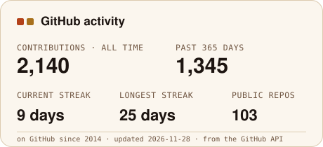
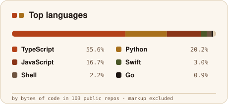

  
  
  
  

### Hey, I'm Joe.

I've spent 20+ years in tech, from the help desk to AI ops. These days I'm a Sr AI Operations Engineer, and I run **[Arch Badger 500, LLC](https://archbadger500.com)**, where I help software companies get stalled implementations live.

- Building and running products with a team of AI agents, mostly on **Cloudflare Workers + D1**
- Self-hosting 25+ apps on my own **Kubernetes** cluster
- Building baseball apps for fun, and serving as commissioner of the family NFL pick'em
- Started my career delivering pizzas

 

## What I'm shipping

| | Project | What it does | Status |
|:-:|---|---|---|
| 💡 | **[Ideabot](https://ideabot.leboube.ai)** | The daily record of what people actually do with AI agents: the top 5 real use cases every morning, each with the result, a prompt to copy and the source. |  |
| 🟧 | **[Pop a Pixel](https://popapixel.com)** | A daily picture puzzle. Start from a blurry mosaic, pop only the tiles you choose, and name the picture in as few pops as you can. |  |
| ⚾ | **[Third Base Math](https://thirdbasemath.com)** | Turns a GameChanger season export into printable steal, bunt and send-or-hold cards for youth, high school and travel coaches. Runs in the browser and uploads nothing. |  |
| 📒 | **[Agent Ledger for Jira](https://marketplace.atlassian.com/apps/2416986037/agent-ledger-ai-coding-agent-analytics-for-jira)** | Shows which Jira work items AI coding agents handled, how their pull requests held up, and what each item cost. |  |
| 🔎 | **[Spec Watch for Jira and Confluence](https://archbadger500.com/spec-watch/support)** | Flags Confluence specs and runbooks when a linked Jira issue changes after the page was last edited. |  |
| ✅ | **[Agent-Ready Check for Jira](https://archbadger500.com/agent-ready-check/docs)** | Scores whether an AI coding agent can start on a Jira work item, and shows what to fix before you hand it over. |  |
| 🌙 | **[Duskclerk](https://duskclerk.com)** | An AI night clerk for small trade shops that answers only after hours. Not answering real calls yet; try a test call in the browser simulator. |  |
| 🔊 | **[Shirp](https://shirp.party)** | Send text and files between devices using sound, in audible or near-ultrasonic modes. |  |

The Atlassian apps are built by Arch Badger 500, LLC. More at <a href="https://joeleboube.com/work/">joeleboube.com/work</a>.

## What I build with

  
  
  
  
  
  
  
  
  
  
  
  
  

## On GitHub

  <picture>
    <source media="(prefers-color-scheme: dark)" srcset="https://raw.githubusercontent.com/jleboube/jleboube/profile-assets/stats-dark.svg" />
    
  </picture>
  <picture>
    <source media="(prefers-color-scheme: dark)" srcset="https://raw.githubusercontent.com/jleboube/jleboube/profile-assets/languages-dark.svg" />
    
  </picture>

  <picture>
    <source media="(prefers-color-scheme: dark)" srcset="https://raw.githubusercontent.com/jleboube/jleboube/profile-assets/snake-dark.svg" />
    
  </picture>

The cards and the snake are rebuilt every 12 hours by a GitHub Action in this repo, straight from the GitHub API. No third-party stat servers.
